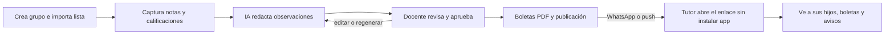

# PRD: Aula Lista

> Versión del 11/10/2026. Este archivo es la versión vigente del PRD; el documento de discusión original está en [Claude Docs](https://claude.ai/code/artifact/93c78d7a-015f-4293-b5fe-566208a6a57a).

## 1. Resumen

Aula Lista es una app web (PWA) para docentes de primaria y secundaria en México (ambos niveles desde el MVP), y después en LatAm. Les ahorra el cierre de periodo: capturan calificaciones y notas en el celular durante el periodo, la IA redacta un borrador de observación por alumno que el docente aprueba, el sistema genera la boleta en PDF y los tutores la ven por un enlace, sin instalar nada.

- **Cliente inicial:** el docente de escuela pública, que lo adopta y lo paga por su cuenta.
- **Fase 2:** la escuela, que paga por un panel del director y avisos generales.
- **Fase 3:** la escuela privada, con módulos extra (libros digitales, cobros, app con su marca).

## 2. Problema

El docente pierde noches en cada cierre de periodo: junta calificaciones dispersas en libretas y Excel, escribe observaciones alumno por alumno y llena boletas. Además atiende a los padres desde su WhatsApp personal. Las apps escolares existentes se venden a la dirección, obligan al padre a instalar una app y reciben quejas por sesiones que se cierran y por no poder ver a varios hijos con una sola cuenta.

**Por validar:** horas que dedica hoy un docente al cierre de periodo. Se mide con 10 entrevistas (guía y registro en Google Sheets, PA-02).

## 3. Usuarios

| Rol | Necesidad | Acceso | Fase |
| --- | --- | --- | --- |
| Docente | Capturar rápido, cerrar el periodo sin desvelarse, informar a los tutores | Correo o Google | MVP |
| Tutor | Ver avance, boletas y avisos de todos sus hijos sin instalar nada | Enlace personal | MVP |
| Director | Ver todos los grupos y enviar avisos generales | Cuenta de escuela | F2 |
| Escuela privada | Libros digitales, cobros y marca propia | Cuenta de escuela con módulos | F3 |
| Administrador interno | Operar y medir el piloto | Panel interno | MVP |

El alumno no tiene cuenta en el MVP.

## 4. Objetivos y métricas del piloto

| Métrica | Meta | Medición |
| --- | --- | --- |
| Docentes activos | 30 | Capturaron algo en los últimos 14 días |
| Docentes que cierran un periodo con la app | 60% de los activos | Publicaron boletas de al menos un grupo |
| Tiempo para cerrar un grupo de 30 alumnos | Menos de 1 hora | Del inicio del cierre a la publicación |
| Observaciones aceptadas sin cambios mayores | 70% | Edición menor a 30% del texto |
| Tutores que abren el enlace | 50% | Aperturas sobre enlaces enviados |
| Docentes que pagan después de la prueba | 20% | Conversión a Pro |

## 5. Alcance del MVP

Incluido: cuenta del docente, grupos y alumnos con importación, rubros y captura de calificaciones sin conexión, notas por alumno, cierre de periodo con observaciones de IA, boletas PDF, portal de tutores, avisos y planes de pago. El detalle está en `01-requerimientos.md` y en las specs.

Fuera del MVP: libros digitales, chat y foros, exámenes en línea, cuentas de alumno, planeación con IA, asistencia, panel del director, cobros de colegiaturas, app nativa, formato oficial de boleta de la SEP (se cubre con exportación a Excel) y facturación CFDI.

## 6. Diseño y movimiento

La app debe sentirse como una app nativa y cuidada, no como una plantilla. El diseño visual parte del skill **Impeccable** y se mejora combinando todos los skills de animación y diseño disponibles: los de Emil Kowalski, Design Motion Principles (Emil Kowalski, Jakub Krehel y Jhey Tompkins), y los de sistema de diseño, entrega, accesibilidad y textos de Claude. El movimiento es de transiciones 2D, rápido y con propósito: confirma lo que hizo el docente, ubica en qué pantalla está y suaviza los cambios. No hay animación 3D ni efectos en las acciones que se repiten cientos de veces, como capturar calificaciones. Las reglas, las curvas, las duraciones y el catálogo de transiciones están en `reglas/07-diseno-y-movimiento.md` (ADR-0010, RNF-025, RNF-026).

## 7. Flujo principal

## 8. Modelo de negocio

| Plan | Incluye | Precio inicial (hipótesis del piloto) |
| --- | --- | --- |
| Gratis | Grupos ilimitados, captura, notas, exportación a Excel, avisos por push y correo, compartir por WhatsApp del docente | 0 |
| Prueba Pro | Todo Pro en 1 grupo, elegido por el docente, durante su primer cierre de periodo | 0 |
| Pro por grupo (máximo 50 alumnos) | Cierre con observaciones de IA, boletas PDF publicadas en el portal, notificación por WhatsApp del sistema con límite mensual | 79 MXN al mes el primer grupo y 29 MXN cada grupo adicional, en un solo cobro |
| Escuela (F2) | Pro para toda la plantilla y panel del director | Por alumno al año, por definir |
| Escuela privada (F3) | Módulos extra | Por módulo, por definir |

Costo variable estimado por grupo Pro: unos 5 MXN al mes (IA con Haiku 5.5 y WhatsApp de boletas). WhatsApp de utilidad en México cuesta 0.0085 USD por mensaje (unos 0.16 MXN) según la tabla de Meta vigente desde el 1/10/2026. Los avisos frecuentes van por push y correo para no disparar el costo de WhatsApp.

Pago con Stripe: tarjeta como suscripción mensual y OXXO como prepago de varios meses, porque OXXO no admite cobros recurrentes (ADR-0009).

## 9. Stack

.NET 10 (ASP.NET Core) en el backend, Angular como PWA en el frontend y PostgreSQL. IA con la API de Claude (Haiku 5.5 por defecto). WhatsApp Business Cloud API con número del sistema. Pruebas y piloto en el servidor de prueba de Oracle con Coolify; después se migra a Azure o similar (ADR-0007). Correo con Brevo. Detalle y razones en `docs/decisiones/`.

## 10. Riesgos

| Riesgo | Mitigación |
| --- | --- |
| El docente no paga de su bolsa | Prueba Pro que cubre un cierre completo; precio por grupo bajo |
| Observaciones genéricas | Basadas en notas del docente y ejemplos de su estilo; aprobación obligatoria |
| Costo de WhatsApp | Avisos por push y correo; límite mensual de mensajes del sistema |
| Datos de menores | Datos mínimos, seudonimización ante la IA, aviso de privacidad y revisión legal externa |
| OXXO no disponible para software (MCC 6538) | Confirmar con Stripe el giro de la cuenta; si no se aprueba, solo tarjeta |
| Interfaz genérica o animaciones que estorban | Impeccable como base, combinado con los demás skills de animación y diseño, catálogo cerrado de transiciones y revisión en cada PR |
| Crecer el alcance | Este PRD y sus specs definen el alcance; todo lo demás va a fases posteriores |
| Un solo servidor | Respaldos diarios externos y prueba de restauración mensual |

## 11. Preguntas abiertas

Se registran y resuelven en `docs/04-preguntas-abiertas.md`.
