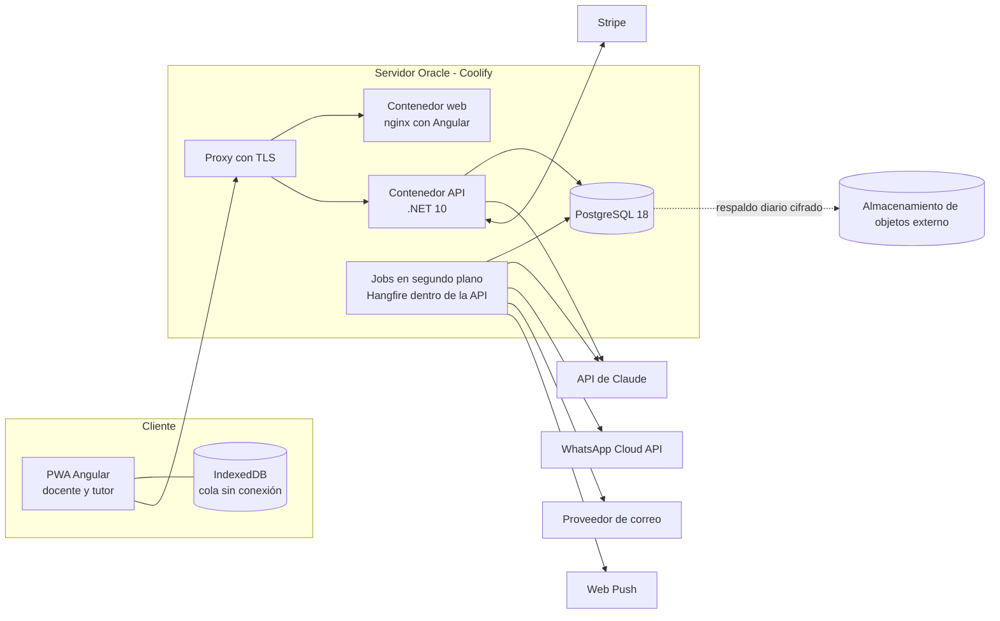
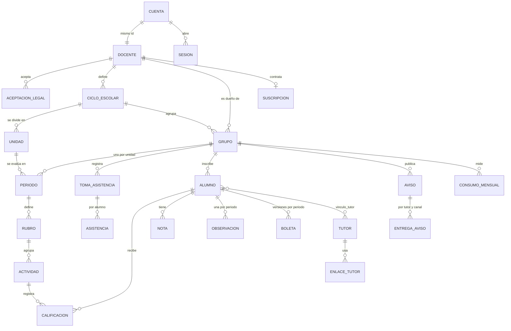

# Arquitectura

Un monolito modular: una API .NET 10, una PWA Angular y una base PostgreSQL, desplegados como contenedores con Coolify: primero en el servidor de prueba de Oracle y, tras las pruebas, en Azure o similar (ADR-0007). Las integraciones externas (Claude, WhatsApp, correo, pagos) se aíslan detrás de interfaces para poder cambiarlas sin tocar el dominio.

## Vista general



## Estructura del repositorio

```
/
├─ CLAUDE.md                 Reglas para agentes de IA que trabajen en el repo
├─ docs/                     Fuente de verdad: PRD, requerimientos, specs, reglas, decisiones
├─ apps/
│  ├─ api/                   Solución .NET 10
│  │  ├─ src/AulaLista.Api            Endpoints (Minimal APIs), autenticación, composición
│  │  ├─ src/AulaLista.Application    Casos de uso, validaciones, puertos (interfaces)
│  │  ├─ src/AulaLista.Domain         Entidades, reglas de negocio, cálculos
│  │  ├─ src/AulaLista.Infrastructure EF Core, Postgres, Claude, WhatsApp, correo, PDF, pagos
│  │  └─ tests/                       Unit, integración (Testcontainers) y arquitectura
│  └─ web/                   Proyecto Angular (PWA)
│     └─ src/app/
│        ├─ core/            Autenticación, HTTP, sincronización sin conexión
│        ├─ shared/          Componentes y utilidades comunes
│        ├─ docente/         Funciones del docente, una carpeta por módulo
│        └─ tutor/           Portal del tutor
└─ infra/                    docker-compose, Dockerfiles, configuración de Coolify y respaldos
```

Módulos del backend (carpetas dentro de cada capa, no proyectos separados): `Cuentas`, `Grupos`, `Evaluacion`, `Cierre`, `Boletas`, `Tutores`, `Avisos`, `Planes`, `Operacion`. Un módulo no accede a las tablas de otro directamente; usa los casos de uso de ese módulo.

## Modelo de datos

Todas las tablas tienen `id` (UUID v7 generado en la aplicación), `created_at` y `updated_at` en UTC. Las tablas con datos de un docente tienen `docente_id` para el aislamiento con Row Level Security. Los nombres de tablas y columnas van en español y `snake_case`.



| Tabla | Campos principales | Notas |
| --- | --- | --- |
| `cuenta` | correo (normalizado, único), hash_contrasena (nulo si solo Google), correo_verificado_en, google_sub (único), estado (activa, eliminacion_solicitada), eliminacion_solicitada_en | Sin RLS; se busca por correo o por hash de token (ADR-0013) |
| `token_cuenta` | cuenta_id, proposito (verificar_correo, restablecer_contrasena), hash (SHA-256, único), expira_en, usado_en | Sin RLS; de un solo uso |
| `sesion` | cuenta_id, familia_id, hash (SHA-256, único), metodo (contrasena, google), autenticada_en, expira_en, usada_en, revocada_en | Sin RLS; una fila por token de actualización rotado |
| `docente` | id (el de `cuenta`), nombre, nivel (primaria, secundaria), escuela_nombre, escuela_cct, entidad_federativa, zona_horaria, prueba_pro_usada | Una fila por cuenta; RLS sobre `id` |
| `aceptacion_legal` | docente_id, documento (terminos, privacidad, declaracion_datos), version, fecha | Inmutable: `app_runtime` solo inserta y lee; única por docente, documento y versión |
| `exportacion` | docente_id, estado (pendiente, lista, fallida), ruta_excel, ruta_pdf, expira_en | Archivos en `IAlmacenArchivos` durante 24 h (RF-008) |
| `ciclo_escolar` | docente_id, nombre (ej. 2026-2027), inicio, fin, tipo_unidad (bimestre, trimestre, cuatrimestre, semestre, mensual, personalizada) | Del docente (RN-022); máximo 13 meses |
| `unidad` | ciclo_escolar_id, docente_id, nombre, orden, inicio, fin | Sin traslape dentro del ciclo (RN-023); restricción de exclusión sobre `daterange` |
| `grupo` | docente_id, nombre, nivel, grado, materia, ciclo_escolar_id, plan (gratis, pro), calif_minima, calif_aprobatoria, decimales_final (0, 1, 2), redondeo (arriba, abajo, cercano), valor_retardo (1, 0.5, 0; decimal 3,2), archivado_en | Máximo 50 alumnos activos |
| `periodo` | grupo_id, unidad_id, estado (abierto, en_cierre, cerrado) | Uno por grupo y unidad (RN-025); nombre y fechas vienen de la unidad |
| `tipo_rubro` | nombre, descripcion, icono, comportamiento (actividades, asistencia), forma_sugerida (numerica, cumplimiento), nombres_sugeridos (text[]), orden, activo | Catálogo global sin `docente_id`; lo edita solo `admin` (ADR-0012) |
| `auditoria_admin` | admin_id, accion, entidad, entidad_id, antes (jsonb), despues (jsonb), fecha | Inmutable |
| `rubro` | periodo_id, nombre, tipo_rubro_id, peso (decimal 5,2), forma (numerica, cumplimiento), calif_minima (decimal 4,2), orden | Pesos suman 100 por periodo |
| `criterio` | rubro_id, nombre, peso (decimal 5,2), forma (numerica, cumplimiento), calif_minima (decimal 4,2), orden | Subrubro; pesos suman 100 por rubro (RN-111) |
| `actividad` | rubro_id, nombre, fecha, modo (individual, por_equipo), orden | |
| `equipo` | grupo_id, docente_id, nombre | |
| `equipo_alumno` | equipo_id, alumno_id | Un alumno en un equipo a la vez (RN-114) |
| `actividad_equipo` | actividad_id, nombre_equipo, alumno_id | Composición con que se calificó (RN-116) |
| `toma_asistencia` | grupo_id, docente_id, fecha | Única por grupo y fecha (RN-100); la unidad se deduce de la fecha |
| `asistencia` | toma_asistencia_id, alumno_id, estado (presente, retardo, falta, justificada), version | Única por toma y alumno |
| `calificacion` | actividad_id, alumno_id, valor (decimal 4,2, nulo), marca (ninguna, cumplio, no_cumplio, no_entrego, exento), origen (individual, equipo, ajustada), version | Única por actividad y alumno; con criterios, `valor` es el resultado de RN-112 |
| `calificacion_criterio` | actividad_id, alumno_id, criterio_id, valor (decimal 4,2, nulo), marca (ninguna, cumplio, no_cumplio) | Detalle por criterio |
| `alumno` | grupo_id, nombres, apellidos, numero_lista, trato (neutro, el, ella), seudonimo, baja_en | Sin CURP ni fecha de nacimiento |
| `tutor` | telefono_e164 (único), nombre, correo, push_suscripciones (jsonb) | Compartido entre docentes; ver RN-061. RLS sin FORCE: el docente solo lee tutores con los que tiene vínculo y se crea por la función `vincular_tutor` (ADR-0014) |
| `vinculo_tutor` | alumno_id, tutor_id, docente_id, nombre, correo, telefono_e164, parentesco | Lo que capturó cada docente; máximo 3 tutores por alumno |
| `importacion` | grupo_id, docente_id, origen (excel, csv, texto), confirmada_en | Solo metadatos; el archivo no se guarda (ADR-0014) |
| `enlace_tutor` | tutor_id, token_hash, creado_por_docente_id, expira_en, revocado_en, ultimo_uso_en | |
| `nota` | alumno_id, periodo_id, texto, etiqueta (fortaleza, mejora, conducta, ninguna), fecha | |
| `observacion` | alumno_id, periodo_id, estado (sin_generar, generando, borrador, aprobada, publicada), borrador_ia, texto_final, instrucciones, modelo, tokens_entrada, tokens_salida, aprobada_en | Una por alumno y periodo |
| `boleta` | alumno_id, periodo_id, version, datos (jsonb con la foto de calificaciones), pdf_ruta, publicada_en, reemplazada_por | Las versiones no se borran |
| `aviso` | grupo_id, docente_id, titulo, cuerpo, urgente, destinatarios (todos o lista) | |
| `entrega_aviso` | aviso_id, tutor_id, canal (push, correo, whatsapp, compartido), estado, leido_en | |
| `mensaje_whatsapp` | grupo_id, tutor_id, plantilla, categoria, id_meta, estado, costo_estimado | Base del límite mensual |
| `consumo_mensual` | grupo_id, mes, mensajes_whatsapp, tokens_ia_entrada, tokens_ia_salida | |
| `suscripcion` | docente_id, proveedor, modalidad (tarjeta, prepago_oxxo), id_externo, estado, grupos_pro, periodo_actual_fin, pagado_hasta, gracia_hasta | |
| `auditoria` | actor_tipo, actor_id, accion, entidad, entidad_id, fecha, ip | Inmutable: `app_runtime` solo inserta; sin RLS; la retención anula `ip` de las cuentas borradas |
| `evento_producto` | docente_id, nombre, propiedades (jsonb), fecha | Para métricas; sin datos personales |

## Aislamiento de datos (RNF-001)

1. Cada solicitud autenticada abre una transacción y fija `SET LOCAL app.docente_id` o `app.tutor_id` desde el token.
2. Las políticas de Row Level Security filtran por esas variables en todas las tablas con datos de alumnos.
3. Además, cada consulta de EF Core filtra explícitamente por dueño (filtros globales de consulta).
4. La app se conecta con un rol de base de datos sin `BYPASSRLS`. Las migraciones usan otro rol.
5. Las pruebas de integración intentan leer datos de otro docente y de otro tutor en cada endpoint y deben fallar.

Excepción: `cuenta`, `token_cuenta` y `sesion` no tienen RLS porque se leen antes de conocer al docente (inicio de sesión, tokens). Solo las usan los casos de uso de `Cuentas` y se buscan por hash del token o correo normalizado (ADR-0013).

## API

- REST con JSON, prefijo `/api/v1`. Recursos en español y plural: `/api/v1/grupos/{id}/alumnos`.
- Errores con Problem Details (RFC 9457) y un `codigo` estable en español, por ejemplo `pesos_no_suman_100`.
- Mutaciones que pueden venir de la cola sin conexión aceptan el encabezado `Idempotency-Key` (UUID del cliente).
- Fechas en ISO 8601 UTC; el cliente las muestra en la zona horaria del docente.
- Paginación por cursor en listas que pueden crecer (avisos, auditoría).
- Contrato documentado con OpenAPI generado por la API; el cliente Angular se genera de ese contrato.
- Las rutas `/api/v1/admin/...` exigen la política `admin`; para cualquier otro usuario responden 404.

## Tipos de rubro extensibles (ADR-0012)

- Cada comportamiento implementa `ICalculoRubro` en el dominio (promedio del rubro de un alumno a partir de sus datos) y tiene su gemelo en el frontend, probados con los mismos vectores de `vectores-calculo.json`.
- La PWA registra un componente de captura por clave de comportamiento. Si recibe una clave que no conoce, muestra "Actualiza la app".
- `GET /api/v1/admin/comportamientos` lista las claves registradas en el código desplegado; el panel solo permite elegir esas.

## Sincronización sin conexión (RF-037, RNF-014)

1. Al abrir un grupo, la PWA descarga a IndexedDB el grupo, alumnos, unidades del ciclo, periodo abierto, rubros, actividades, calificaciones, tomas de asistencia de la unidad y notas.
2. Cada cambio local se guarda en IndexedDB y en una cola de salida con un UUID de idempotencia y la `version` conocida del registro.
3. Al haber conexión, la cola se envía en orden a `POST /api/v1/sincronizacion` en lotes de hasta 100 cambios.
4. Conflictos: por celda de calificación gana la última escritura según la hora del servidor; las notas nunca chocan porque cada nota es un registro nuevo. El cliente recibe la versión vigente y actualiza su copia.
5. La UI muestra siempre el estado: "Guardado", "Pendiente de enviar (n)" o "Sin conexión".
6. Lo que no funciona sin conexión: generar observaciones, publicar boletas, enviar avisos y pagos.

## Jobs en segundo plano

Hangfire con almacenamiento en PostgreSQL (esquema `hangfire`, instalado por el migrador), dentro del proceso de la API. Los trabajos pedidos en una solicitud se encolan solo después de confirmar su transacción (ADR-0013).

| Job | Disparador | Reintentos |
| --- | --- | --- |
| Generar observaciones de un grupo | El docente lo pide en el cierre | 3, con espera exponencial |
| Generar boletas PDF | Al publicar | 3 |
| Enviar notificaciones (push, correo, WhatsApp) | Al publicar boletas o avisos | 5 |
| Procesar webhooks de pagos y de WhatsApp | Webhook recibido | 5 |
| Generar exportación de datos (RF-008) | El docente la pide | 3 |
| Limpieza por retención (RNF-009) | Diario a las 03:00, hora del centro de México | 3 |
| Respaldo de la base | Diario, desde el contenedor de respaldos | Alerta si falla |

## Integraciones

| Servicio | Uso | Interfaz en Application |
| --- | --- | --- |
| API de Claude | Observaciones (Haiku 5.5) y lectura de fotos de listas | `IRedactorObservaciones`, `ILectorListas` |
| WhatsApp Cloud API | Plantillas de boleta disponible y aviso urgente | `IMensajeriaWhatsApp` |
| Correo (Brevo, ADR-0008) | Verificación, recuperación, avisos | `IEnvioCorreo` |
| Web Push (VAPID) | Avisos y boletas | `INotificacionPush` |
| Stripe | Suscripción con tarjeta y prepago en OXXO (ADR-0009) | `IPasarelaPagos` |
| QuestPDF | Boletas | `IGeneradorBoletas` |
| Almacenamiento de objetos | PDFs, exportaciones y respaldos; en el piloto, disco del servidor en un volumen (ADR-0013) | `IAlmacenArchivos` |

## Entornos

| Entorno | Dónde | Datos |
| --- | --- | --- |
| Local | docker-compose en la máquina del desarrollador | Datos ficticios generados |
| Staging | Servidor de prueba de Oracle con Coolify, subdominio aparte | Datos ficticios |
| Pruebas con docentes | Servidor de prueba de Oracle con Coolify | Datos reales del piloto; respaldos externos obligatorios |
| Producción | Azure o similar, tras las pruebas (ADR-0007) | Datos reales migrados con `pg_dump` y verificación |

Las imágenes se construyen para `linux/amd64` y `linux/arm64`, porque el servidor gratuito de Oracle suele ser ARM y Azure suele ser x86. Ningún componente depende de un servicio exclusivo de Oracle.

Nunca se copian datos reales de producción a local o staging.
